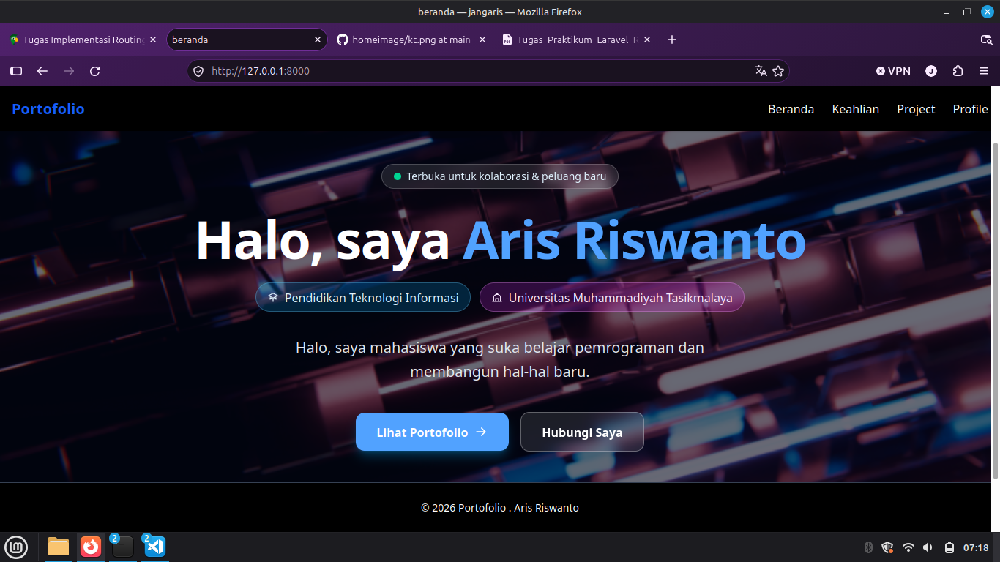
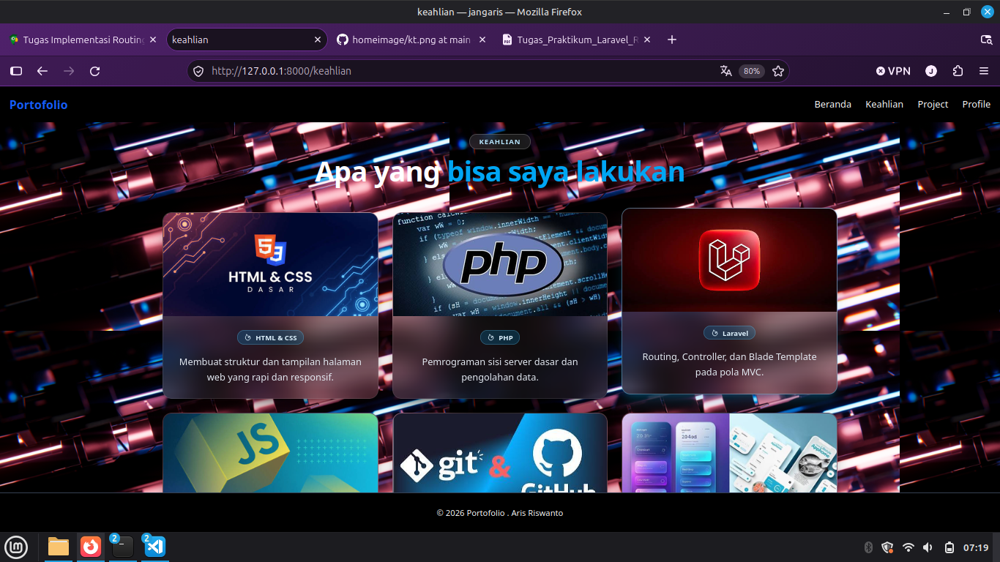
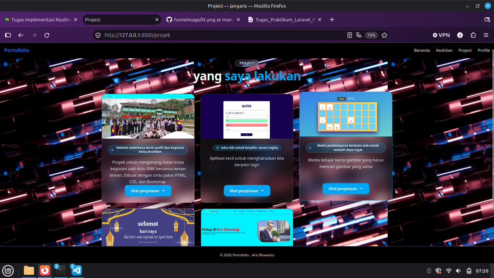
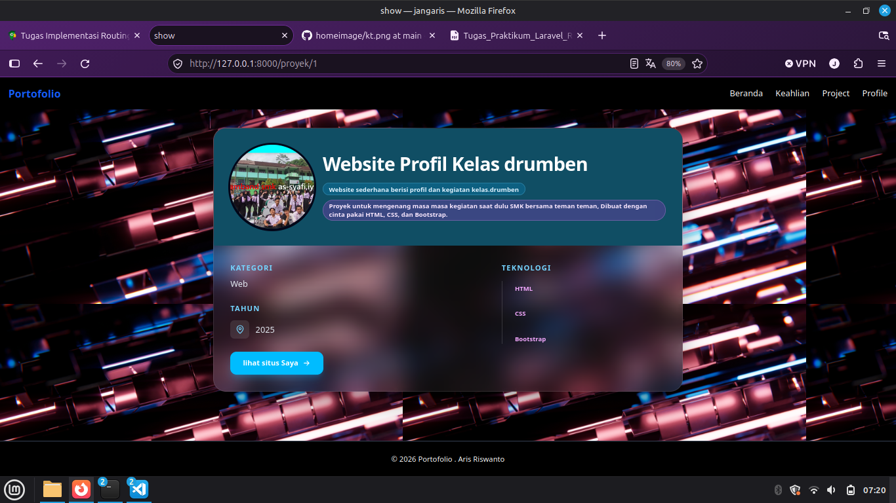
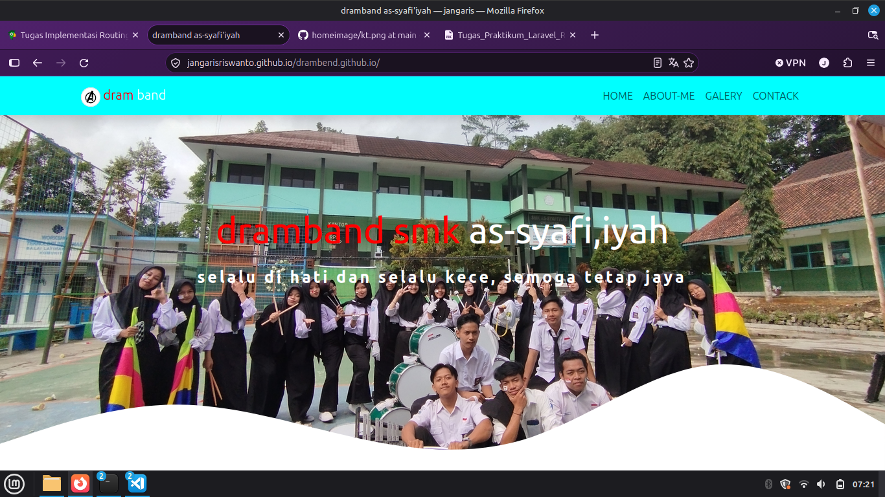
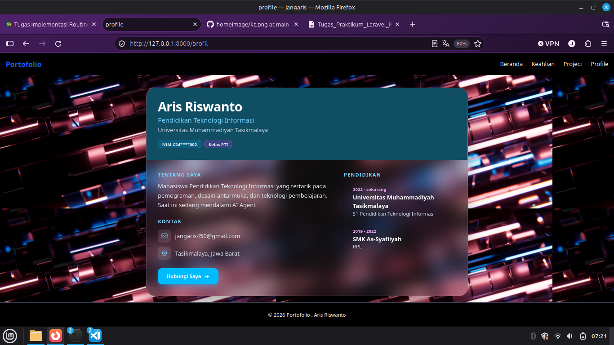

# Praktikum Laravel - Implementasi Routing dan Konsep MVC

**Nama:** Aris Riswanto  
**NIM:** C2483207002
**Kelas:** PTI5A
**Program Studi:** Pendidikan Teknologi Informasi  
**Universitas:** Universitas Muhammadiyah Tasikmalaya (UMTAS)

**Mata Kuliah:** Pemrograman Internet  
**Tema Proyek:** Portofolio Mahasiswa  
**Framework:** Laravel

---

## Deskripsi Aplikasi

Website Portofolio Mahasiswa merupakan aplikasi berbasis web yang dikembangkan menggunakan framework Laravel. Aplikasi ini dibuat untuk menampilkan informasi mengenai profil mahasiswa, keahlian, serta proyek-proyek yang pernah dikerjakan.

Proyek ini menerapkan konsep dasar arsitektur MVC (Model-View-Controller), khususnya alur Routing, Controller, dan View. Seluruh data yang ditampilkan menggunakan array PHP pada Controller tanpa menggunakan database.
dan di sini saya menggunakan taiwind untuk css nya supaya tampilan situs nya lebih enak di lihat

## Fitur dan Halaman

Website ini memiliki beberapa halaman utama, yaitu:

1. **Beranda:** Menampilkan halaman utama website.
2. **Profil:** Menampilkan informasi profil mahasiswa.
3. **Keahlian:** Menampilkan daftar kemampuan atau keahlian.
4. **Project:** Menampilkan daftar Project yang pernah dibuat.
5. **Detail Project:** Menampilkan informasi detail berdasarkan ID proyek melalui parameter URL.

## Implementasi Routing, Controller, dan View

### 1. Routing

Routing digunakan untuk mengatur alamat URL yang dapat diakses oleh pengguna. Konfigurasi Route diletakkan pada file `routes/web.php`.

Setiap Route menggunakan metode GET dan diarahkan menuju method tertentu pada Controller.

### 2. Controller

Controller berfungsi sebagai penghubung antara Routing dan View. Controller mengolah serta menyiapkan data menggunakan array PHP, kemudian mengirimkan data tersebut ke halaman Blade.

Pada aplikasi ini terdapat dua Controller yang menangani halaman utama dan informasi proyek.

### 3. View

View digunakan untuk menampilkan data kepada pengguna melalui Blade Template Laravel.

Implementasi View menggunakan:

- `@extends` untuk menggunakan layout utama.
- `@section` untuk mengisi bagian konten halaman.
- `@yield` untuk menampilkan konten dari section.
- `@foreach` untuk menampilkan data secara berulang.

## Screenshot Aplikasi

### Halaman Beranda



### Halaman Detail Keahlian



### Halaman Daftar Project



### Halaman Detail DetailProject



### Halaman Ketika kita klik lihat situs



### Halaman Detail profile



## Cara Menjalankan Proyek

Pastikan PHP dan Composer sudah terinstal pada komputer.

**unduh salinan repository GitHub ke komputer lokal.**

```bash
git clone https://github.com/USERNAME/REPOSITORY.git
```

**Masuk ke file yang di unduh tadi**

```bash
cd REPOSITORY

```

**pastikan sudah ada composer nya dan PHP nya lalu ketik ini akan menginstal dependency sesuai versi yang tercatat di dalamnya**

```bash
composer install
```

**Salin file konfigurasi environment, nah ini code nya berguna jiga kita melakukan clone, karena .env nya gak di masukan ke github, jadi kita pakai code di bawah ini supaya bisa membuat file .env sendiri berdasarkan template tersebut.**

```bash
cp .env.example .env
```

**setelah itu kita harus Generate application key di sini laravel akan menghasilkan kunci acak dan memasukkannya ke konfigurasi .env.**

```bash
php artisan key:generate
```

**Jalankan server Laravel**

```bash
php artisan serve
```

**Buka aplikasi melalui browser**
Buka `http://127.0.0.1:8000` di browser.
